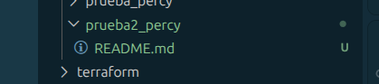
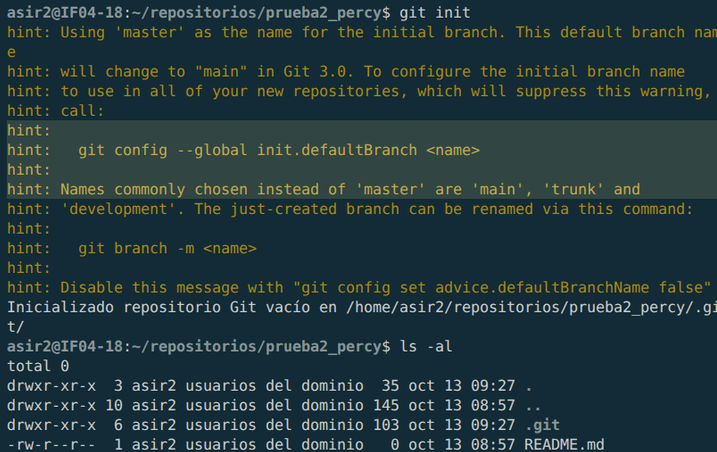
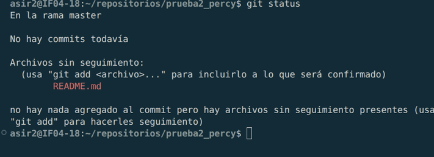
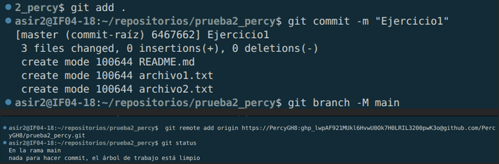
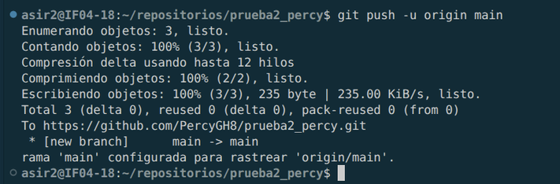
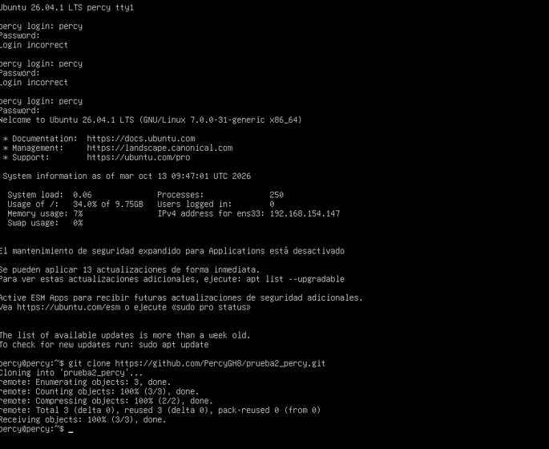
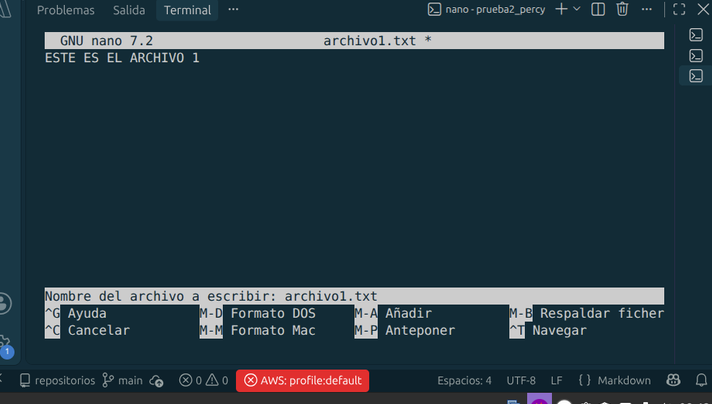
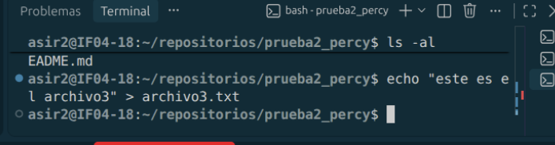
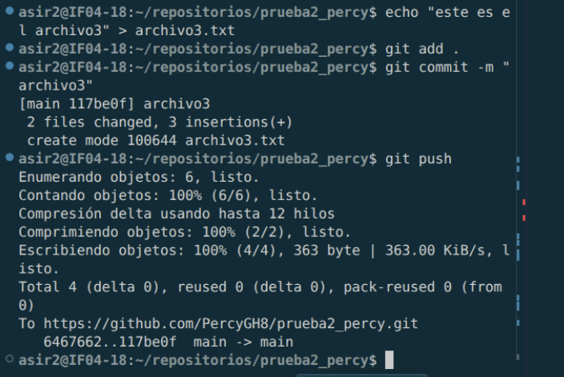
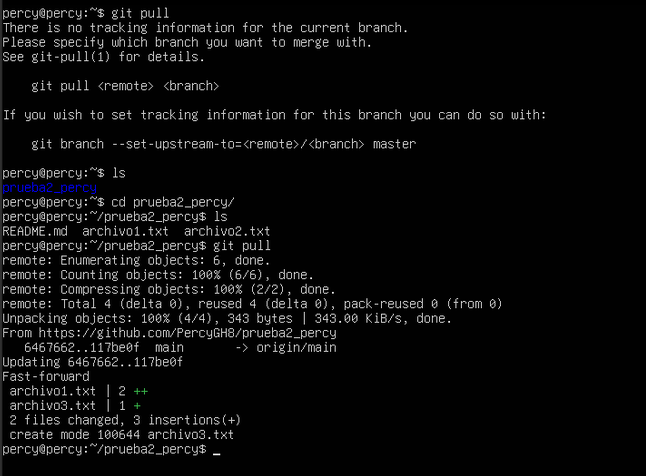

# Implantación de aplicaciones web
## Ejercicio 1: Introducción a git y GitHub

#### 1º. Lo primero que vamos realizar es la creacion del repositorio desde el Visual Code, donde creare "prueba2_percy" y en el que creare un README.md, deberia de quedarnos tal que asi desde la vista del Visual Code:

----
#### 2º.   Hacemos un git init para iniciar el repositorio seguido de un "ls-al" para comprobar que esta iniciado con el .git

---
#### 3º.  Seguios con un STATUS  para comprobar el readme.md deberia de sañir en rojo ya que todavia nos queda hacer el COMMIT y el ADD .

---

#### 4º. A continuación tras conectar nuestra carpeta repositorio con GitHub hacemos con GIT PUSH y lo publicamos a nuestro GitHub

#### 5º. Seguimos con el ejercicio clonando nuestro repositorio de GitHub a una máquina virtual en mi caso en un ubuntu server 26.04, con un GIT CLONE y la URL de nuestro GitHub

#### 6º. Procedemos a editar el archivo1.txt con un nano para editar su interior

De seguido continuamos con la creacion del archivo3.txt con el ECHO:

Finalizamos con un git add . seguido del commit -m, para finalmente poder hacer el git push y subir los archivos creados y actualizados al GitHub:

#### 7º. Para finalizar la tarea-1, tras actualizar y subir los cambios a nuestro repositorio del GitHub, actualizamos el repositorio clonado en nuestro ubuntu server con un GIT PULL:

---

