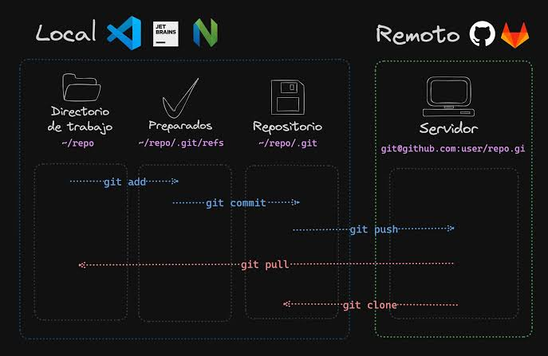

# Ejercicio 2: Introducción a Markdown

## MI PRIMER MARKDOWN

Este párrafo tiene palabras en **negrita**, otras en *cursiva* y alguna en `código`. Markdown es un lenguaje de marcas ligero y se convierte a HTML sin liarse mucho.

```bash
git add ejercicio2.md
git commit -m "Añado ejercicio2"
git push
```

1. Crear el repositorio
2. Añadir los ficheros
3. Hacer commit
4. Subirlo con push

- Git
- GitHub
- Markdown

Visita [Markdown Guide](https://www.markdownguide.org/cheat-sheet/) para ver más sintaxis.

Mira también el [otro documento](Ejercicio1.md) del repositorio.



| Comando    | Función                    |
|------------|----------------------------|
| git add    | Prepara los cambios        |
| git commit | Guarda los cambios         |
| git push   | Sube los cambios a remoto  |