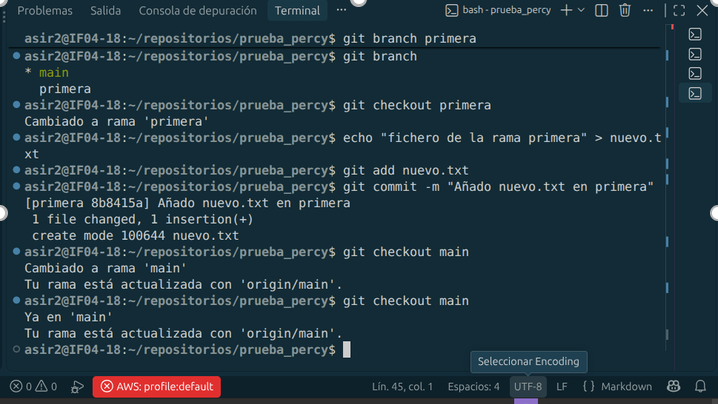
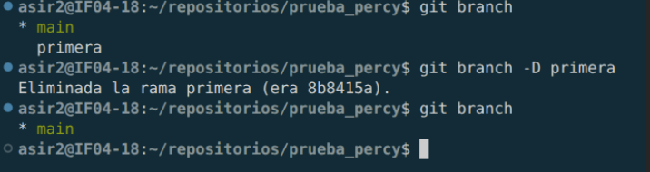
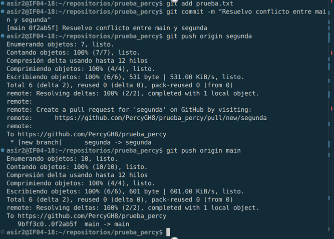
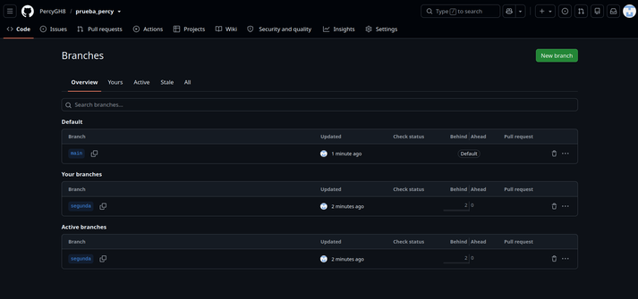

# Ejercicio 3: Ramas y uniones en Git

## 1. Rama primera
```bash
git branch primera
git branch
```


## 2. Fichero nuevo y merge


**¿Hay conflicto?** No. Main no había cambiado desde que se creó la rama y el fichero es nuevo, así que Git hace un fast-forward sin nada que reconciliar.




## 3. Borrado de la rama primera
```bash
git branch -d primera
```



## 4. Conflicto con la rama segunda
Contenido de `prueba.txt` con el conflicto:
```
<<<<<<< HEAD
Buenas, qué pasa
=======
hola que tal
>>>>>>> segunda
```

### 4.1: Comandos realizados para Prueba.txt -->



## 5. Resolución y sincronización
(comandos usados y contenido final del fichero)

