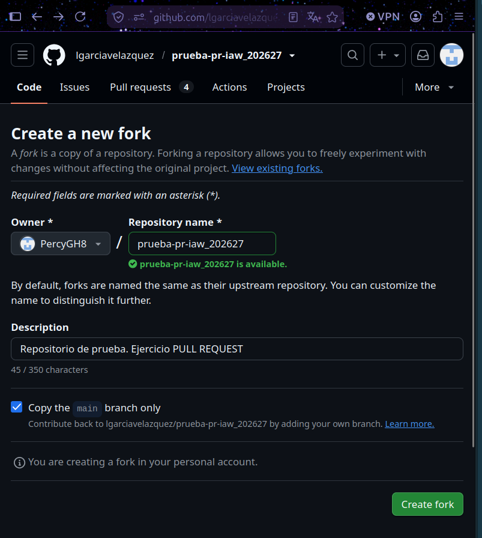
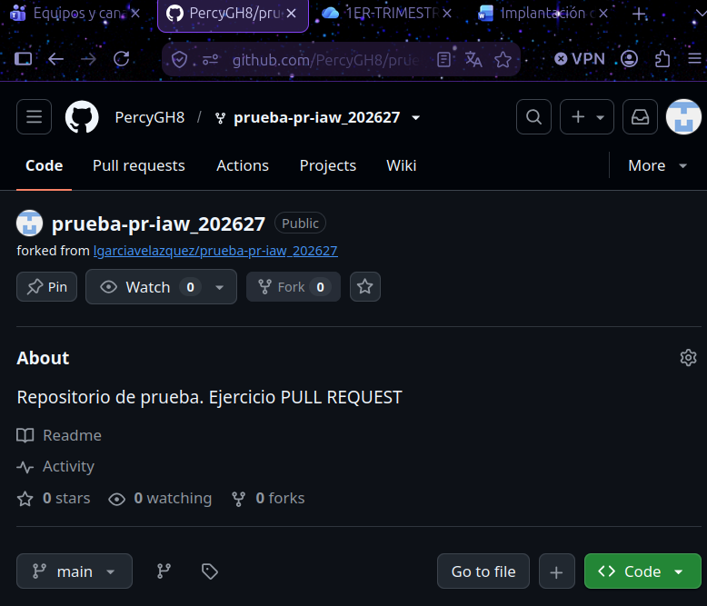
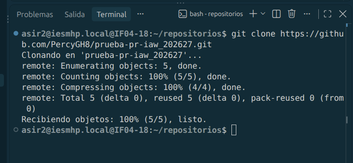
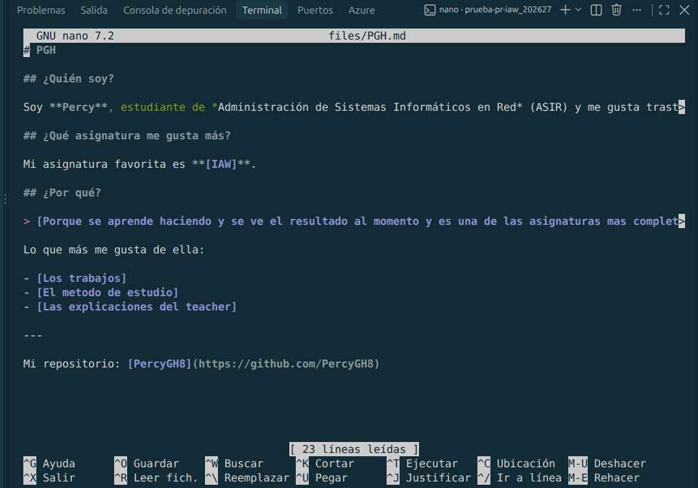
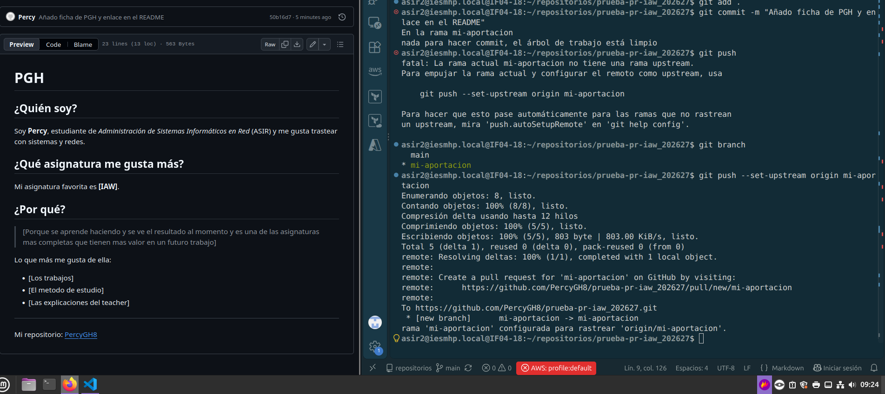
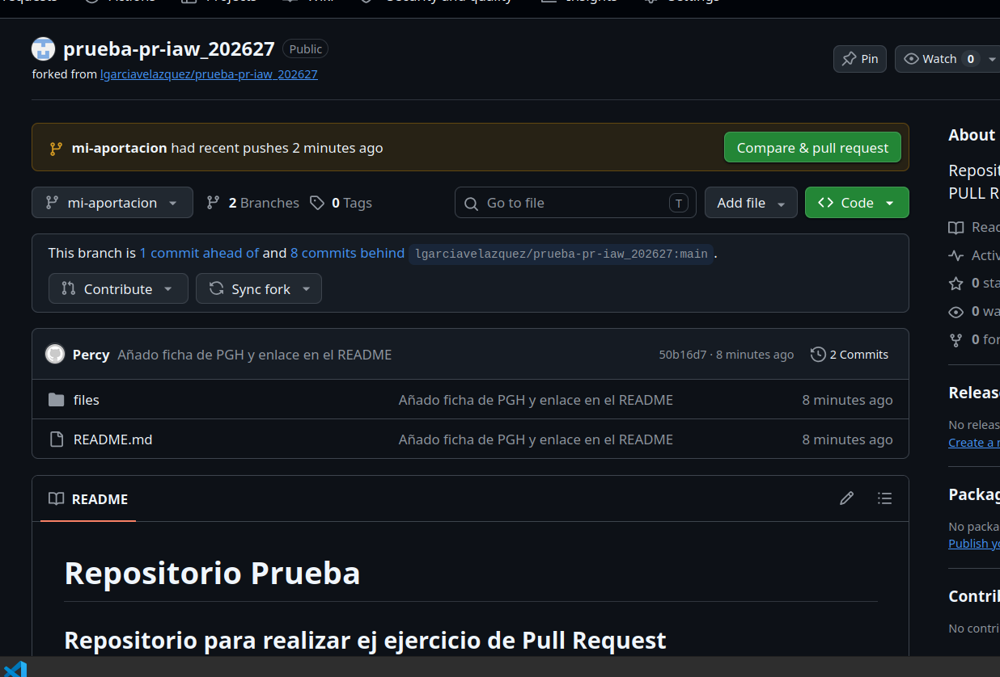
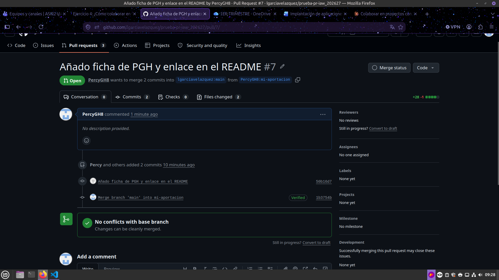
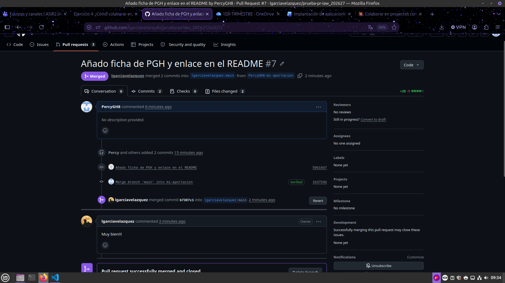

# Ejercicio 4: Colaborar en un proyecto de software libre mediante Pull Request

## Objetivo

Un **Pull Request (PR)** es una petición que se hace al propietario de un repositorio original para que incorpore los cambios que se le sugieren. Permite colaborar en proyectos ajenos sin tener permisos de escritura sobre ellos: se trabaja en una copia propia (*fork*) y se solicita que los cambios se integren en el repositorio original.

En este ejercicio se realiza un PR sobre el repositorio `lgarciavelazquez/prueba-pr-iaw_202627` para:

- Añadir en el `README.md` un enlace con mis iniciales (**PGH**) que apunte a `files/PGH.md`.
- Crear el fichero `files/PGH.md` con la respuesta a las preguntas *¿Quién eres?*, *¿Qué asignatura te gusta más?* y *¿Por qué?*, usando al menos 5 marcas distintas de Markdown.

> Nota: las imágenes se enlazan desde la carpeta `imagess/` del repositorio. Si la carpeta tiene otro nombre, hay que ajustar las rutas.

---

## Paso 1. Hacer el fork del repositorio original

Desde la web de GitHub, en el repositorio `lgarciavelazquez/prueba-pr-iaw_202627`, se pulsa **Fork**. Se elige como propietario mi cuenta (`PercyGH8`), se mantiene el nombre del repositorio y se pulsa **Create fork**.



Resultado: el repositorio queda copiado en mi cuenta y GitHub indica que procede del original (*forked from lgarciavelazquez/prueba-pr-iaw_202627*).



---

## Paso 2. Clonar el fork en local

Se clona **mi fork** (no el original) por HTTPS, fuera del repositorio `prueba_percy` para no anidar repositorios:

```bash
cd ~/repositorios
git clone https://github.com/PercyGH8/prueba-pr-iaw_202627.git
cd prueba-pr-iaw_202627
```



---

## Paso 3. Crear una rama nueva

Antes de modificar nada se crea una rama para los cambios, de modo que `main` quede intacta y el PR solo contenga mi aportación:

```bash
git checkout -b mi-aportacion
git branch
```

El asterisco de `git branch` debe estar sobre `mi-aportacion`.

---

## Paso 4. Realizar los cambios

### 4.1 Añadir el enlace en el `README.md`

Se añade una línea nueva al final de la lista, respetando el formato de las entradas existentes:

```bash
echo "* [PGH](files/PGH.md)" >> README.md
tail -n 4 README.md
```

### 4.2 Crear el fichero `files/PGH.md`

```bash
nano files/PGH.md
```

El fichero responde a las tres preguntas y utiliza varias marcas de Markdown: títulos, negrita, cursiva, cita, listas, línea horizontal y enlace.



---

## Paso 5. Commit y push de la rama

Se añaden los cambios, se hace el commit con un mensaje descriptivo y se sube la rama al fork. Al ser una rama nueva, hay que indicar el *upstream* con `--set-upstream`:

```bash
git add .
git commit -m "Añado ficha de PGH y enlace en el README"
git push --set-upstream origin mi-aportacion
```

En la captura se ve que un `git push` sin configurar la rama remota da error, y que con `--set-upstream origin mi-aportacion` la rama se sube correctamente. A la izquierda se muestra el fichero ya renderizado en GitHub.



---

## Paso 6. Crear el Pull Request

Tras el push, en mi fork aparece el aviso *mi-aportacion had recent pushes* con el botón **Compare & pull request**. La rama indica que está 1 commit por delante y 8 por detrás del `main` del repositorio original.



Antes de crear el PR se comprueba que:

- **Base:** `lgarciavelazquez/prueba-pr-iaw_202627`, rama `main`.
- **Head:** `PercyGH8/prueba-pr-iaw_202627`, rama `mi-aportacion`.

Se pone un título significativo y se pulsa **Create pull request**. El PR queda abierto como **#7**, sin conflictos con la rama base (*No conflicts with base branch*) y con 2 commits: el de mis cambios y el de integración de `main` en mi rama.

URL del Pull Request: <https://github.com/lgarciavelazquez/prueba-pr-iaw_202627/pull/7>



---

## Paso 7. Esperar la aceptación y sincronizar el repositorio

Una vez que el profesor acepte el PR, hay que sincronizar el repositorio local y el fork para tener los ficheros de todos los compañeros. Se añade el repositorio original como remoto `upstream`:

```bash
git remote add upstream https://github.com/lgarciavelazquez/prueba-pr-iaw_202627.git
git checkout main
git pull upstream main
git push origin main
```

---

